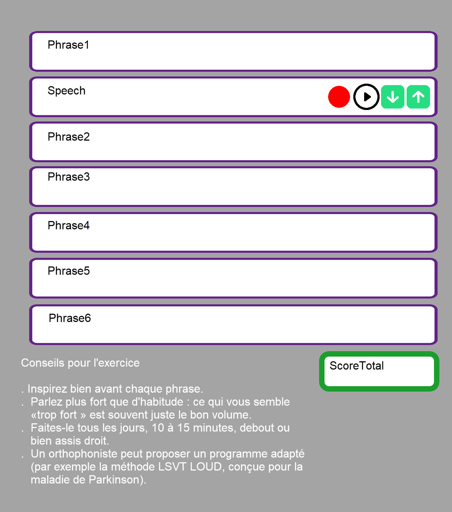

# ParkinsonAide

A Windows desktop app that helps people with Parkinson's disease practise speaking clearly and loudly.
The patient reads a French sentence aloud. The app transcribes it offline with an open-source
speech-to-text engine ([Vosk](https://alphacephei.com/vosk/)) and shows how many of the words were recognised.

It is designed for the **Seeed Studio ReSpeaker XVF3800** microphone array, but works with any microphone.
All text in the app is in French. The full specification is in [`Docs/FD.md`](Docs/FD.md),
and the layout mockup is [`pictures/GUI.jpg`](pictures/GUI.jpg).



## Features

- Shows 6 consecutive sentences from a text file (Phrase 1 – Phrase 6).
- **Record** (red button): hold it while reading Phrase 1 aloud. Recording stops 0.5 s after release.
- The transcription appears in the **Parole** field with a score from 0 % to 100 %, the share of words
  in Phrase 1 that were recognised.
- **Play**: listen to the last recording.
- **Down / Up**: move one sentence back or forward through the file. Each sentence keeps its own
  transcription and score while you move around.
- **Score total**: the average score of all sentences recorded so far.
- Exercise tips in the bottom-left corner.
- Create, open, edit and save sentence files. The last used file opens automatically at startup.
- Works fully offline. No audio leaves the computer.

## Requirements

- Windows 10/11 (64-bit)
- [Rust](https://rustup.rs/) 1.85 or newer (the crate uses edition 2024)
- Vosk library for Windows, version 0.3.45
- A French Vosk model

The Vosk library and models are **not in the git repository** because they are too large. Download them as described below.

## Setup

1. **Vosk library**: download `vosk-win64-0.3.45.zip` from the
   [Vosk releases](https://github.com/alphacep/vosk-api/releases) and extract its contents into `vosk/`:

   ```
   vosk/libvosk.dll
   vosk/libvosk.lib
   vosk/libgcc_s_seh-1.dll
   vosk/libstdc++-6.dll
   vosk/libwinpthread-1.dll
   ```

   A different location can be used by setting the `VOSK_LIB_PATH` environment variable.
   The build copies the DLLs next to the executable automatically.

2. **French model**: download one from the [Vosk models page](https://alphacephei.com/vosk/models)
   and extract it so that `am/final.mdl` is directly inside the folder:

   | Folder          | Model                     | Notes                                       |
   |-----------------|---------------------------|---------------------------------------------|
   | `vosk_small_fr` | `vosk-model-small-fr-0.22` | ~40 MB, loads in about a second (default)  |
   | `vosk_fr`       | `vosk-model-fr-0.22`       | ~1.4 GB, more accurate, slow to load, needs a lot of RAM |

   At startup the app looks for `vosk_small_fr`, then `vosk_fr`, next to the executable and in the folders
   above it. Another folder can be chosen under **Paramètres → Micro et reconnaissance vocale…**.

## Build and run

```
cargo run --release
```

The executable is `target/release/ParkinsonAide.exe`. To run it on another PC, copy the executable,
the Vosk DLLs, a model folder and `phrases.txt` into one folder.

Speech recognition is enabled by the default `stt` feature. `cargo build --no-default-features` builds
without Vosk, for working on the UI without the library.

## Installer

```
pwsh installer\build.ps1
```

This builds the release exe and compiles `installer\ParkinsonAide.iss` with
[Inno Setup 6](https://jrsoftware.org/isinfo.php) (`winget install JRSoftware.InnoSetup`). The result is
`target\installer\ParkinsonAide-Setup-<version>.exe`, about 50 MB, with French installer screens.

- Installs for the current user in `%LOCALAPPDATA%\Programs\ParkinsonAide`, so no administrator rights are needed.
- Includes the app, the Vosk DLLs and the small French model. The large model is not included.
- Copies `phrases.txt` to `Documents\ParkinsonAide`, where the user can edit and save it. An existing copy is never overwritten.
- Adds a Start-menu shortcut, an optional desktop shortcut and an uninstaller.

The C runtime is linked statically (`.cargo/config.toml`), so the target PC does not need the Visual C++ Redistributable.
The version number comes from `Cargo.toml`.

## Usage

1. Plug in the microphone. A ReSpeaker/XVF3800 is selected automatically if one is connected.
2. Start the app. The last sentence file opens, or `phrases.txt` on first launch.
3. Hold t0he red button, read **Phrase 1** aloud, then release it.
4. Read the transcription and score, press Play to listen back, and use the green arrows to move to the next sentence.

### Sentence files

A plain UTF-8 text file with one sentence per line. Empty lines are ignored. Windows-1252 files are also read.

- **Fichier**: Nouveau, Ouvrir… (Ctrl+O), Enregistrer (Ctrl+S), Enregistrer sous…
- To edit a sentence, click in its field and type.
- To add a sentence at the end, type in the first empty field ("Nouvelle phrase…").
- **Édition**: insert a sentence before or after Phrase 1, delete Phrase 1, clear all results.
- The app asks before discarding unsaved changes.

### Settings

**Paramètres → Micro et reconnaissance vocale…**

- **Microphone**: automatic (prefers the XVF3800) or a specific device.
- **Channel**: mix of all channels, left only, or right only. The XVF3800 outputs two processed channels.
- **Vosk model folder**: choose and load another model.

Settings and the last used file are stored in `%APPDATA%\ParkinsonAide\config.json`.

## Scoring

Both the sentence and the transcription are lower-cased and split into words. Apostrophes, hyphens and punctuation count as word breaks.
The score is the percentage of words in the sentence that also appear in the transcription. Each spoken word can match only once.
Word order and extra words do not affect the score. Numbers written as digits (`12`) do not match the spoken form (`douze`),
so write numbers out in full in sentence files.

## XVF3800 notes

The app uses the microphone as a standard USB audio device with its factory settings and does not send any
configuration commands to it. Documentation and tools for tuning the device are in `Docs/`:

- `xvf3800_user_guide_v3.2.1.pdf`: user guide
- `usage_xvf_host.md`, `xvf_host.py`, `respeaker_get_doa.py`: control commands and Python examples
- `reSpeaker-Console-v0.1.8-Windows.msi`: Seeed's configuration tool

## Tests

```
cargo test
```

Runs the scoring unit tests. To test transcription end to end on a WAV file (mono, 16 kHz, 16-bit):

```
PA_TEST_WAV=path/to/file.wav cargo test transcribe_wav -- --ignored --nocapture
```

## Project layout

```
src/main.rs      window setup
src/app.rs       GUI, record/playback flow, file handling
src/audio.rs     microphone capture (cpal), resampling, WAV, playback (rodio)
src/stt.rs       Vosk speech-to-text and model discovery
src/phrases.rs   sentence file load/save and scoring
src/config.rs    persistent settings
build.rs         links Vosk and copies its DLLs next to the executable
icons/           button images
phrases.txt      example sentences
```
